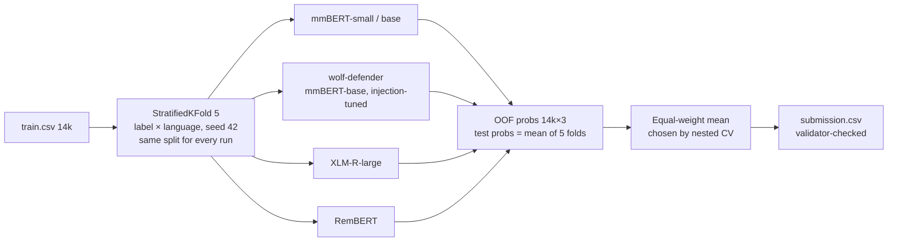

# Multilingual Prompt-Attack Classification — Team Fprinciples (RMIT Hackathon 2026 · Challenge 1)

> Detecting **BENIGN**, **JAILBREAK** and **PROMPT_INJECTION** prompts written in Portuguese, French, Italian and English,
> using only the organisers' approved backbones and the competition's `train.csv`.

[Kaggle competition](https://www.kaggle.com/competitions/rmit-hackathon-2026) · Challenge 2 repo:
[A_RmitHackathon2026_c2](https://github.com/bminhnemhoi/A_RmitHackathon2026_c2) · Metric: **macro-F1** (3 classes, equal weight)

---

## TL;DR

| | |
|---|---|
| **Best validated system** | Equal-weight ensemble of 9 fine-tuned encoders from 4 approved families (mmBERT, wolf-defender, XLM-R-large, RemBERT) |
| **Out-of-fold macro-F1** (5-fold, all 14,000 train rows) | **0.9776** (Portuguese 0.969 · French 0.986 · Italian 0.986 · English 0.974) |
| **Best single model** | RemBERT 0.9678 (train.csv only) · mmBERT-base + pseudo-labels 0.9690 |
| **Public LB check** | an earlier 2-model blend scored OOF 0.9666 → public **0.9635**, so OOF tracks the leaderboard to ~0.003 |
| **Main remaining error** | long (>400 chars) **Portuguese role-play** prompts where BENIGN and JAILBREAK share the same adversarial framing; ~50 rows are wrong for *every* model (probable label noise) |

All numbers in this README come from real runs logged in [`experiments/log.csv`](experiments/log.csv). Nothing is tuned on the
test set or the public leaderboard.

---

## 1. Problem

| | |
|---|---|
| Input | `text` (10 – 18,550 chars, median 294) + `language` ∈ {pt, fr, it, en} |
| Output | one label ∈ {`BENIGN`, `JAILBREAK`, `PROMPT_INJECTION`} |
| Data | `train.csv` 14,000 rows · `test.csv` 6,000 rows · class mix 62 / 31 / 7 % — identical in every language |
| Constraints | approved backbones only (10 models, see [docs/CONTEXT.md](docs/CONTEXT.md)); **no external data** (confirmed by organisers); no manual labelling of test; 6 submissions |

Full brief and rules: [docs/CONTEXT.md](docs/CONTEXT.md).

## 2. What the data told us

Detailed reports with charts: [EDA](docs/analysis/eda/EDA.md) · [error analysis](docs/analysis/errors/ERRORS.md) ·
[provenance](docs/analysis/provenance/PROVENANCE.md) · [model profiles](docs/analysis/MODEL_PROFILES.md).

1. **Construction recipe (inferred).** English prompts from public safety datasets, labels inherited from the source, sampled with
   fixed per-language quotas (62/31/7), then machine-translated to fr/it/pt. PROMPT_INJECTION is mostly *deepset*/*SPML*-style
   "ignore previous instructions"; JAILBREAK is *WildJailbreak*-style adversarial role-play; BENIGN mixes short questions with
   adversarial-*benign* role-play. *(We only analysed public sources; none were used for training.)*
2. **No covariate shift** (adversarial-validation AUC 0.48), no duplicates, no id-order leak, labels shuffled across ids.
3. **The whole gap is Portuguese.** 223 of 290 ensemble errors are pt; without pt the error rate is 0.87 %.
   pt prompts longer than 400 chars are ~50/50 BENIGN/JAILBREAK with *the same* role-play wrappers → 5.5 % error.
4. **Simple cues don't separate the hard slice** ("comece sua resposta com", "fins educacionais", …: precision 0.38–0.69).
5. **Calibration is already good** (ECE 0.006); threshold / class-multiplier tricks do not help under honest evaluation.
6. **Label-noise floor:** ~50 rows are mis-predicted by all 11 models; oracle best-of-models would leave only 50 errors.

## 3. Approach



* **Full fine-tuning** of each approved encoder (`AutoModelForSequenceClassification`, 3 labels; safety-tuned 2-class heads are
  replaced). bf16 autocast on A10G/L40S, AdamW, linear warm-up 10 %, grad-clip 1.0, class-weighted CE (weights ∝ freq^-0.5).
* **Head + tail truncation** (70 % head / 30 % tail) so the end of long prompts — where injected instructions often sit — is kept.
* **ModernBERT specifics** (mmBERT, wolf): SDPA attention (no FlashAttention on T4), RoPE θ pinned for transformers 4.x.
* **5-fold OOF for everything** → every model is scored on all 14k rows; runs are blendable because they share folds.
* **Pseudo-labelling (one round)**: confident (p ≥ 0.98) predictions of our own ensemble on test *text* added to training folds
  (approved models only; disclosed in the submission notebook).
* **Ensembling**: equal-weight probability mean. Nested CV (repeated, 5 outer seeds) showed every fitted alternative —
  Caruana selection, stacking, fitted weights, per-language routing — scores *below* the equal mean.

## 4. Results (5-fold OOF macro-F1, 14,000 rows)

| Run | Backbone | Key settings | OOF | pt |
|---|---|---|---|---|
| TF-IDF + LR *(diagnostic only, not allowed)* | — | char 2-5 + word 1-2 | 0.927 | 0.908 |
| `mmbert_small_s1` | mmBERT-small | lr 5e-5, 2 ep, len 384 | 0.9583 | 0.942 |
| `xlmrl_lr1e-5_ep5` | XLM-R-large | lr 1e-5, 5 ep, len 320 | 0.9629 | 0.956 |
| `wolf_lr2e-5_ep4` | wolf-defender | lr 2e-5, 4 ep, len 384 | 0.9671 | 0.958 |
| `mmbert_base_lr3e-5_ep3` | mmBERT-base | lr 3e-5, 3 ep, len 384 | 0.9673 | 0.956 |
| `rembert_ep3_v2` | RemBERT | lr 1.5e-5, 3 ep, bs 8×2, len 320 | **0.9678** | 0.959 |
| `mmb_pseudo_ep4` | mmBERT-base | + 5,121 pseudo-labels | 0.9690 | 0.959 |
| **`blend8r_equal`** | 9 runs, 4 families | equal mean | **0.9776** | **0.969** |

### What did *not* work (measured, honest nested evaluation)

| Idea | Result |
|---|---|
| Per-class / per-language probability multipliers | nested −0.001 |
| Fitted blend weights, LR stacking, Caruana, per-language routing | all below equal mean |
| max_len 768 (wolf / mmBERT) | ±0.000 |
| Up-weighting the hard pt slice ×2 | −0.0016 single, −0.0007 blend |
| Label smoothing 0.1 (+ higher LR) | −0.0005 / −0.0024 single |
| FGM + EMA + LLRD | EMA decay too high for ~350 steps/epoch; FGM doubles time |
| Mistral-7B LoRA (last-token head) | fold-0 0.9638; hurts the blend |
| Cross-lingual twin / kNN label copying | fixes 5, breaks 6 |

## 5. Repository layout

```
docs/                     brief (CONTEXT), plan, research (RESEARCH*.md), submission log & checklist
docs/analysis/            EDA, error analysis, provenance, model profiles, architectures, decision layers (+ charts)
modal_jobs/train_modal.py k-fold encoder fine-tuning on Modal (folds in parallel) + OOF aggregation
modal_jobs/train_lora.py  LoRA last-token classifier for the approved LLMs (Mistral-7B, Granite-2B)
src/c1/                   metrics, class-multiplier search, ensembling utilities
scripts/                  validate_submission.py · blend_runs.py · make_kaggle_bundle.py · py_to_ipynb.py
notebooks/                Kaggle notebooks (training notebook + ensemble submission notebooks)
experiments/log.csv       one row per run — real numbers only
tests/                    pytest for the validator
```

Data (`data/`), model outputs (`outputs/`, `*.npy`) and secrets are git-ignored. **Never commit competition data**
(CC BY-NC-SA 4.0, Kaggle rules).

## 6. Reproduce

```bash
pip install -r requirements.txt modal && python -m pytest -q
python -m modal setup                                   # authenticate your own Modal workspace
# once: upload the Kaggle zip to the Modal volume
python -m modal run modal_jobs/train_modal.py --upload-zip path/to/rmit-hackathon-2026.zip
# one 5-fold run (folds train in parallel, ~12 min on A10G, ≈ $1–2)
python -m modal run modal_jobs/train_modal.py --model rembert --lr 1.5e-5 --epochs 3 \
       --batch-size 8 --grad-accum 2 --max-len 320 --gpu L40S --run rembert_ep3_v2
# blend runs on OOF and write a validated submission
python scripts/blend_runs.py --runs wolf_lr2e-5_ep4 rembert_ep3_v2 --name my_blend --no-class-weights
python scripts/validate_submission.py --sample outputs/runs/mmbert_small_s1/_sample.csv \
       --submission outputs/runs/my_blend/submission.csv
# package for Kaggle (dataset folder + notebook that names every backbone and prints the training code)
python scripts/make_kaggle_bundle.py --blend my_blend --runs wolf_lr2e-5_ep4 rembert_ep3_v2
```

On Windows prefix commands with `PYTHONUTF8=1` and call Modal as `python -m modal`.
Trainer flags: `--model --lr --epochs --batch-size --grad-accum --max-len --seed --folds ("0,1,2,3,4" or -1 for a 100 % refit)
--label-smoothing --class-weight-power --head-ratio --lang-prefix --llrd --ema --fgm --pseudo <run> --pseudo-thr --hard-weight --gpu`.

## 7. Contributing (team workflow)

1. One branch + one git worktree per person/agent: `git worktree add ../c1-wt/<topic> -b c1/<topic>`.
2. Change **one thing at a time**, keep `--seed`-independent fold split (`split_seed=42`) so OOFs stay comparable.
3. Log every run in `experiments/log.csv` (real numbers only) and add it to a blend with `scripts/blend_runs.py`.
4. A run is accepted into the ensemble only if the blend's OOF improves **≥ +0.0003, in ≥ 3/5 folds, without hurting pt**.
5. Conventional commits (`feat(c1): …`), PR into `main`, no force-push. Rules for humans *and* AI agents: [AGENTS.md](AGENTS.md).

### Open problems — where help is most valuable

* **Portuguese long role-play (BENIGN ↔ JAILBREAK).** Needs semantic judgement of the *underlying* request. Candidates:
  an approved decoder LLM done right (Granite-3.3-2B / Mistral-7B LoRA with longer context and stable LR — see
  [docs/analysis/ARCHITECTURES.md](docs/analysis/ARCHITECTURES.md)), more RemBERT seeds/epochs, a second pseudo-label round.
* **Label noise.** ~50 rows wrong for every model — robust losses (e.g. bootstrapping, co-teaching) may help generalisation.
* **Diversity.** New families (RemBERT was the biggest single ensemble gain) beat more seeds of existing ones.

## 8. Compliance

Approved backbones only · train.csv only (no external data, organiser-confirmed) · no manual or LLM labelling of test ·
pseudo-labels from our own approved models disclosed in the notebook · submissions are `id,label` CSVs with 6,000 rows in sample
order, checked by [`scripts/validate_submission.py`](scripts/validate_submission.py). Team/notebook name `RMIT_SGS_Fprinciples_C1`.

## 9. References

Research notes with links: [RESEARCH.md](docs/RESEARCH.md) · [RESEARCH_V2.md](docs/RESEARCH_V2.md) ·
[RESEARCH_V3_GUARDS.md](docs/RESEARCH_V3_GUARDS.md) (Llama Prompt Guard 2, Qwen3Guard, WildGuard, PolyGuard) ·
[RESEARCH_V4_SCOUT.md](docs/RESEARCH_V4_SCOUT.md). Key papers: mmBERT (JHU, 2025), XLM-R (Conneau et al., 2020),
RemBERT (Chung et al., 2021), WildJailbreak / WildGuard (AllenAI, 2024), PIGuard / InjecGuard (2024–25),
Low-Resource Languages Jailbreak GPT-4 (Yong et al., 2023).

---

<sub>Team Fprinciples · RMIT Hackathon 2026 (Security × Generative AI × Low-Resource Languages).
Experiment orchestration and analysis assisted by Claude Code.</sub>
