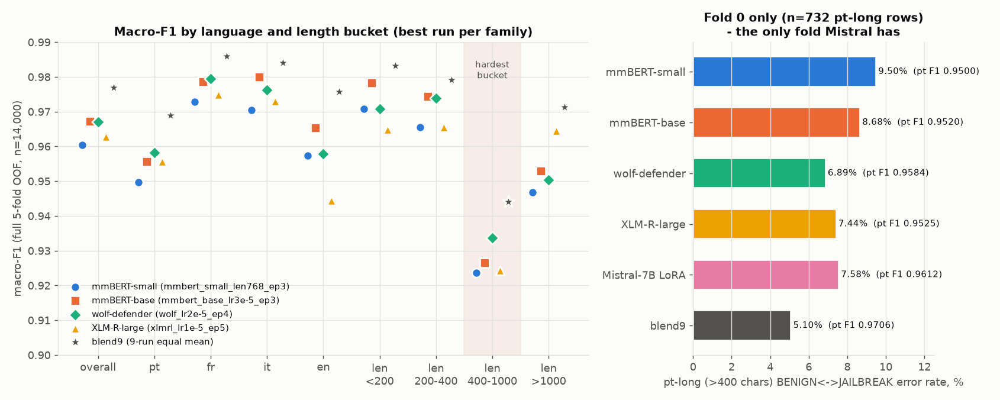
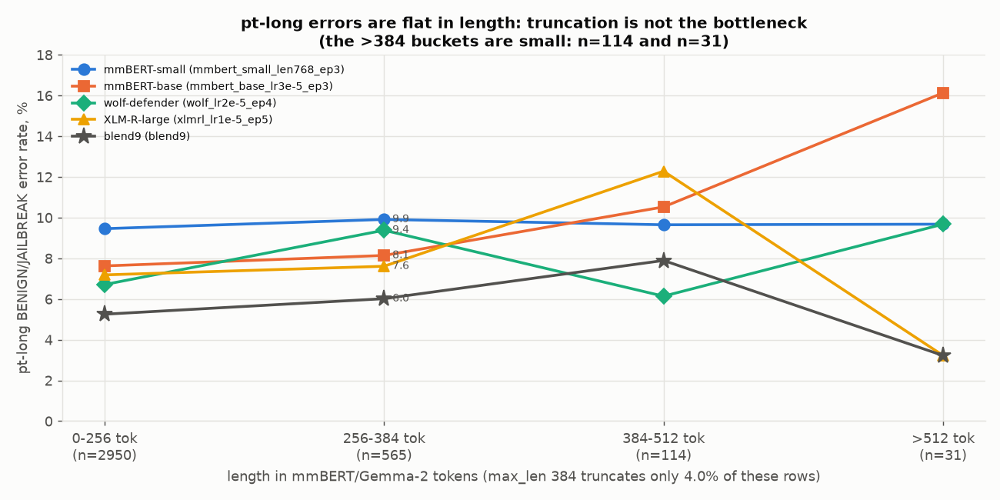
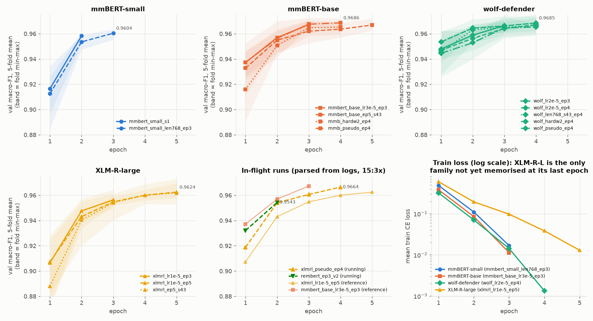
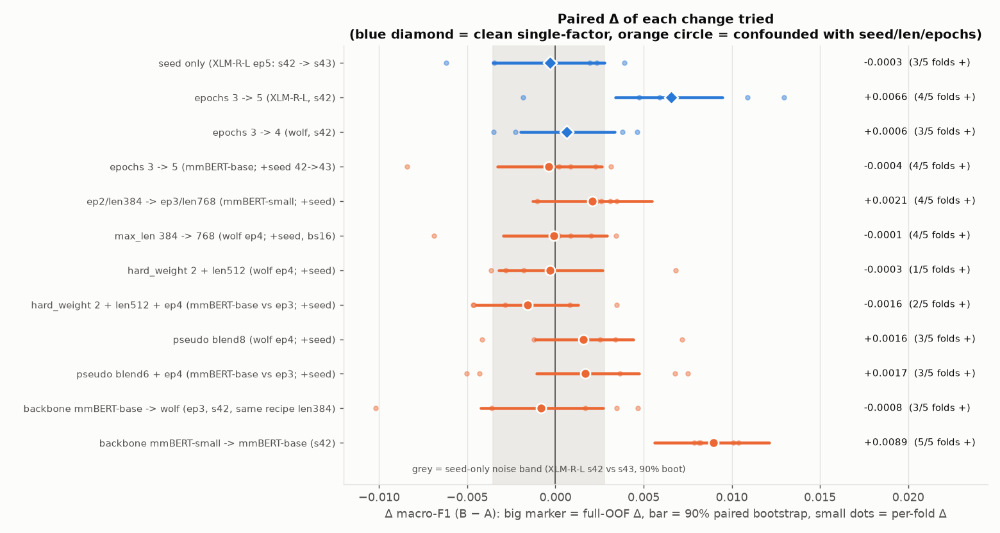

# Model profiles — mỗi backbone khác nhau ở đâu, tune tiếp cái gì

Ngày 2026-10-22, ~15:45. Nguồn số liệu: `outputs/runs/<run>/oof_probs.npy` + `summary.json` của 14 full-OOF runs, `outputs/mistral_fold0.npz`, `outputs/runs/blend9_equal`, và các log đang chạy (`outputs_*.log`). Split: StratifiedKFold(5, shuffle, rs=42) trên `label_language`. Script đã kiểm tra lại split này, và fold 0 khớp đúng `val_idx` của Mistral.
Scripts (scratchpad, không commit): `profiles/profile.py`, `profiles/extra.py`, `profiles/calib.py`, `profiles/charts.py`. Mọi con số dưới đây đều do các script đó tính ra. Không có số nào được ước lượng bằng tay.
Charts: `docs/analysis/profiles/fig1..fig5*.png`. Texts là untrusted data. Script chỉ dùng độ dài, token count và label, không in text nào.

## TL;DR

1. **Best single model (full OOF, không pseudo): `mmbert_base_lr3e-5_ep3` 0.9673 ≈ `wolf_lr2e-5_ep4` 0.9671.** Hai số này chênh nhau trong vùng noise: seed noise trên OOF có 90% CI ±0.003. Nếu tính cả pseudo thì `mmb_pseudo_ep4` 0.9690 và `wolf_pseudo_ep4` 0.9686 cao hơn, nhưng OOF của chúng hơi lạc quan. **Wolf là model tốt nhất trên slice khó nhất** (pt-long BEN↔JB error 7.1% so với 7.9% của mmBERT-base). Đổi lại, nó yếu hơn ở PROMPT_INJECTION và en.
2. **Chỉ có 2 thay đổi vượt khỏi seed noise:** (a) mmBERT-small → mmBERT-base **+0.0089** (5/5 folds), (b) **XLM-R-large 3 → 5 epochs +0.0066** (P>0 = 1.00). Mọi thứ khác đã thử đều nằm trong dải ±0.003: epochs của wolf/mmBERT, max_len 768, hard-weight, pseudo (+0.0016, có confound), đổi mmBERT-base ↔ wolf.
3. **XLM-R-large là family duy nhất còn under-trained**: train loss ở epoch cuối là 0.013, trong khi mmBERT/wolf ≈ 0.001. Val F1 vẫn tăng ở epoch 5 trong 4/5 folds. Nó cũng là family **đa dạng nhất**: Jaccard lỗi với các family khác chỉ 0.25–0.35, có 22 dòng family-unique-correct trên lỗi blend9 (cao nhất), và bỏ nó khỏi blend làm mất −0.0023 (mất nhiều nhất).
4. **Wolf seeds gần như là bản sao của nhau** (Jaccard lỗi 0.45–0.53). Thêm seed wolf hay tune wolf thêm gần như không đem lại gì cho blend.
5. **Truncation không phải nút thắt.** Chỉ 4.0% dòng pt-long bị cắt ở max_len 384 (Gemma-2 tokenizer). Error rate pt-long gần như phẳng theo độ dài token (fig5). len768 cho Δ −0.0001.
6. **Mistral-7B LoRA (fold 0, 1 epoch, len256) là tín hiệu mới duy nhất.** Pt F1 0.9612, **cao nhất trong mọi model trên fold 0**. Error overlap với mọi encoder thấp nhất (Jaccard 0.21–0.32). Thêm vào blend9 làm member thứ 10 (weight 1/10): fold 0 **0.9771 → 0.9789 (+0.0018)**, sửa được 4 dòng và không làm hỏng dòng nào, bootstrap 90% [+0.0003, +0.0039]. Để so sánh, thêm một encoder bất kỳ làm member thứ 10 chỉ cho −0.0012 đến +0.0004. Bằng chứng còn yếu (1 fold, 4 dòng) nhưng đây là **ứng viên có EV cao nhất và rẻ nhất (~$2.5, ~10 phút)**.
7. **0.99 không khả thi trước 18:00** với approved backbones + train.csv. Blend9 có 286 lỗi. Muốn đạt 0.99 thì chỉ được còn ≤ ~124 lỗi. **Kể cả sửa hết 199 lỗi pt-long BEN↔JB cũng mới được 0.9884.** Thực tế OOF có thể lên khoảng 0.978–0.980 (public ≈ 0.975–0.977, nếu trừ gap OOF→public −0.003 đã đo được). Xem §9.

---

## 1. Mỗi model khác nhau ở đâu (architecture / tokenizer / pretraining)

| family | arch | layers × hidden | params | tokenizer (vocab) | chars/token (pt) | pos / ctx | pretraining | ghi chú |
|---|---|---|---|---|---|---|---|---|
| **mmBERT-small** | ModernBERT encoder (local attn 128 + global mỗi 3 layer, RoPE) | 22 × 384 | ~140M (phần lớn là embedding 256k×384) | Gemma-2 SP (256,000) | 4.66 | 8192 | mmBERT: ~3T tokens, 1,800+ ngôn ngữ, annealed language schedule | backbone mỏng, under-capacity |
| **mmBERT-base** | như trên | 22 × 768 | ~307M | Gemma-2 (256,000) | 4.66 | 8192 | như trên | |
| **wolf-defender** | **mmBERT-base + fine-tune binary benign/injection** (v2, Patronus) | 22 × 768 | ~307M | **giống hệt mmBERT-base** (token count trùng 100% trên 14k dòng) | 4.66 | 8192 (card: 2048) | mmBERT + supervised injection/jailbreak data (gộp JB+PI thành 1 nhãn "INJECTION") | head 2→3 được khởi tạo lại (`ignore_mismatched_sizes`) |
| **XLM-R-large** | RoBERTa encoder, absolute pos | 24 × 1024 | ~560M | SentencePiece (250,002) | 4.43 | **512** | CC-100, 100 ngôn ngữ, MLM | max_len 320 cắt 10.9% dòng pt-long |
| **Mistral-7B LoRA** | decoder causal, last-token head | 32 × 4096 | 7.2B (LoRA r16 trên all linear) | Mistral v3 (32,768) | **3.19** | 32k | web-scale LM + instruct | len256 cắt **53.9%** dòng pt-long, chỉ 1 epoch |

Hệ quả đo được:
- **wolf và mmBERT-base dùng cùng architecture, cùng tokenizer, chỉ khác init.** Vậy mà Jaccard lỗi giữa hai family chỉ 0.32–0.39, trong khi trong nội bộ wolf là 0.45–0.53. **Init (task-specific fine-tune) tạo ra diversity ngang với việc đổi backbone.** Wolf bắt đầu cao hơn ngay từ epoch 1 (0.947 so với 0.937). Nó tốt hơn ở pt-long (−0.71pp error khi so cùng recipe ep3/s42) nhưng PI F1 thấp hơn (0.9621 so với 0.9640). Điều này khớp với việc pretraining của nó gộp JB và PI vào một nhãn, nên features không tách được JB với PI.
- **Mistral tokenizer tốn token gấp ~1.46×** (3.19 so với 4.66 chars/token), nên ở len256 nó chỉ thấy một nửa số prompt pt-long. Dù vậy error trên các dòng bị cắt (7.7%) vẫn ≈ các dòng không bị cắt (7.4%). Phần đầu prompt đã chứa đủ tín hiệu, và giới hạn hiện tại là semantic, không phải context.

## 2. Bảng tổng hợp per run (full 5-fold OOF, n = 14,000)

`ptL` = error rate BENIGN↔JAILBREAK trên pt >400 chars, true ∈ {BEN, JB} (n=3,660). `c99` = số lỗi có max-prob > 0.99.

| run | OOF | BEN | JB | PI | pt | fr | it | en | <200 | 200–400 | 400–1k | >1k | ptL % | ECE | NLL | c99 | errors |
|---|---|---|---|---|---|---|---|---|---|---|---|---|---|---|---|---|---|
| mmbert_small_s1 | 0.9583 | .9692 | .9448 | .9610 | .9421 | .9757 | .9713 | .9598 | .9689 | .9714 | .9092 | .9364 | 11.01 | .021 | .129 | 96 | 545 |
| mmbert_small_len768_ep3 | 0.9604 | .9725 | .9523 | .9564 | .9497 | .9728 | .9705 | .9573 | .9708 | .9655 | .9237 | .9469 | 9.54 | .028 | .200 | 235 | 489 |
| **mmbert_base_lr3e-5_ep3** | **0.9673** | .9773 | .9604 | .9640 | .9556 | .9786 | **.9801** | **.9654** | **.9783** | .9744 | .9265 | .9530 | 7.87 | .023 | .169 | 196 | 404 |
| mmbert_base_ep5_s43 | 0.9669 | .9763 | .9588 | .9656 | .9572 | .9789 | .9788 | .9554 | .9697 | .9744 | .9305 | .9548 | 8.03 | .026 | .213 | 239 | 419 |
| mmb_hardw2_ep4 | 0.9657 | .9763 | .9600 | .9608 | .9545 | .9807 | .9737 | .9621 | .9732 | .9773 | .9196 | .9551 | 7.76 | .025 | .216 | 234 | 418 |
| mmb_pseudo_ep4 † | 0.9690 | .9787 | .9619 | .9663 | .9586 | .9818 | .9827 | .9536 | .9722 | .9697 | .9366 | .9608 | 7.30 | .023 | .176 | 191 | 383 |
| wolf_lr2e-5_ep3 | 0.9664 | .9776 | .9618 | .9599 | .9557 | .9794 | .9765 | .9624 | .9692 | .9734 | .9301 | .9625 | 7.16 | .024 | .183 | 232 | 400 |
| **wolf_lr2e-5_ep4** | **0.9671** | .9775 | .9616 | .9621 | .9583 | .9796 | .9762 | .9579 | .9708 | .9739 | .9338 | .9504 | **7.13** | .025 | .196 | 242 | 399 |
| wolf_len768_s43_ep4 | 0.9670 | .9775 | .9621 | .9614 | .9590 | .9767 | .9766 | .9594 | .9738 | .9779 | .9259 | .9553 | 7.30 | .025 | .202 | 263 | 398 |
| wolf_hardw2_ep4 | 0.9668 | .9787 | .9644 | .9572 | .9607 | .9759 | .9737 | .9563 | .9736 | .9732 | .9305 | .9571 | 6.56 | .024 | .205 | 240 | 381 |
| wolf_pseudo_ep4 † | 0.9686 | .9796 | .9655 | .9608 | .9605 | .9809 | .9791 | .9532 | .9730 | .9711 | .9355 | .9627 | 6.45 | .023 | .186 | 235 | 365 |
| xlmrl_lr1e-5_ep3 | 0.9563 | .9726 | .9558 | .9406 | .9483 | .9687 | .9660 | .9402 | .9636 | .9589 | .9117 | .9558 | 8.61 | .029 | .175 | 243 | 487 |
| **xlmrl_lr1e-5_ep5** | **0.9629** | .9767 | .9611 | .9509 | .9557 | .9748 | .9731 | .9445 | .9648 | .9656 | .9243 | **.9646** | 7.38 | .027 | .201 | 296 | 419 |
| xlmrl_ep5_s43 | 0.9626 | .9768 | .9622 | .9487 | .9569 | .9704 | .9687 | .9544 | .9627 | .9648 | .9343 | .9608 | 6.99 | .026 | .198 | 276 | 415 |
| **blend9_equal** | **0.9770** | .9839 | .9719 | .9751 | .9690 | .9859 | .9841 | .9758 | .9833 | .9792 | .9441 | .9713 | 5.44 | **.006** | .065 | 36 | 286 |

† OOF hơi lạc quan vì teacher ensemble đã được train trên mọi fold.



Đọc bảng:
- **Bucket 400–1000 chars là bucket khó nhất với mọi model** (F1 0.909–0.937, blend 0.944). Đây chính là pt-long BEN↔JB. Ở bucket >1000, XLM-R-large lại tốt nhất (0.9646).
- **en và PI là điểm yếu thứ hai, và khác nhau theo family.** XLM-R-large yếu nhất ở en (0.9445) và PI (0.9509). Family mmBERT-base tốt nhất ở en/it/PI (en 0.9654, it 0.9801, PI 0.9656 ở `ep5_s43`). Wolf yếu ở en (0.958) và PI (0.962).
- Lỗi pt-long ở các model đơn **chia gần đều hai chiều** (ví dụ wolf ep4 có 141 BEN→JB và 120 JB→BEN). Riêng `wolf_hardw2` lệch hẳn (98 / 142): hard-weight chủ yếu đẩy bias về phía BENIGN chứ không làm tăng khả năng phân tách.

## 3. pt-long và truncation (fig5)

| tokenizer | p50 / p90 tokens (pt-long) | % pt-long bị cắt @256 | @320 | @384 | @512 | @768 |
|---|---|---|---|---|---|---|
| Gemma-2 (mmBERT, wolf) | 178 / 312 | 19.8% | 9.0% | **4.0%** | 0.9% | 0.05% |
| XLM-R SP-250k | 188 / 325 | 22.9% | **10.9%** | 4.7% | 1.1% | 0.05% |
| Mistral v3 | 261 / 456 | **53.9%** | 30.1% | 17.8% | 5.8% | 0.8% |

pt-long error, chia theo dòng bị cắt / không bị cắt (dùng tokenizer và max_len của từng run): wolf ep4 6.8% / 7.1%, mmBERT-base ep3 11.6% / 7.7% (n cắt = 147), **XLM-R ep5 9.3% / 7.1% (n cắt = 399)**, Mistral 7.7% / 7.4%. Chỉ XLM-R có tín hiệu nhỏ là truncation gây hại, vì len320 cắt 10.9% dòng. Đó là lý do recipe XLM-R đề xuất dùng len 512.



## 4. Calibration

- **Model đơn nào cũng overconfident**: ECE 0.021–0.029, temperature tối ưu (cross-fitted) T = 1.9–2.9, mỗi model có 96–296 lỗi với p > 0.99 (14 runs). Mean confidence trên các dòng sai là 0.83–0.95.
- **Blend9 ECE 0.006**, chỉ còn 36 lỗi có p > 0.99. Lấy trung bình đã tự calibrate.
- **Temperature-scale từng model trước khi average làm blend tệ hơn** (0.9759 so với 0.9770). Geometric mean cũng vậy (0.9768). → Giữ arithmetic mean của raw probs. Calibration **không phải** lever cho argmax. Label smoothing 0.1 (`mmb_ls01_lr5e-5_ep4`, đang chạy) xử lý trực tiếp overconfidence, nhưng chưa có lý do để kỳ vọng nó sửa được BEN↔JB.

## 5. Learning curves (fig2)

| run | val F1 trung bình 5 folds theo epoch | train loss epoch cuối | Δ epoch cuối | folds còn tăng | best_epoch |
|---|---|---|---|---|---|
| mmbert_small_s1 | .9165 → .9583 | 0.083 | **+0.0418** | 5/5 | last |
| mmbert_small_len768_ep3 | .9125 → .9535 → .9604 | 0.017 | +0.0069 | 5/5 | last |
| mmbert_base_lr3e-5_ep3 | .9372 → .9570 → .9672 | 0.011 | +0.0103 | 5/5 | last |
| mmbert_base_ep5_s43 | .9328 → .9549 → .9620 → .9636 → .9669 | **0.0001** | +0.0033 | 5/5 | last |
| wolf_lr2e-5_ep3 | **.9480** → .9588 → .9664 | 0.008 | +0.0076 | 5/5 | last |
| wolf_lr2e-5_ep4 | .9470 → .9562 → .9641 → .9671 | 0.0013 | +0.0030 | 5/5 | last |
| wolf_len768_s43_ep4 | .9455 → .9631 → .9651 → .9664 | 0.0017 | +0.0013 | 3/5 | 2–3 |
| xlmrl_lr1e-5_ep3 | .9065 → .9476 → .9563 | 0.084 | +0.0087 | 5/5 | last |
| **xlmrl_lr1e-5_ep5** | .9073 → .9431 → .9548 → .9600 → .9624 | **0.013** | +0.0024 | 4/5 | 3–4 |
| xlmrl_ep5_s43 | .8880 → .9404 → .9541 → .9600 → .9619 | 0.018 | +0.0019 | 4/5 | 3–4 |
| *xlmrl_pseudo_ep4 (4/4 epochs xong, chưa aggregate)* | .9188 → .9541 → .9606 → .9664 | – | – | – | – |
| *rembert_ep3_v2 (đang chạy, 2/3 epochs)* | .9320 → .9543 | – | – | – | – |
| Mistral fold 0 (1 epoch) | .9638 | 0.30 | – | – | – |

Diễn giải:
- **mmBERT-base và wolf đã memorize xong** (loss 1e-3 đến 1e-4). Thêm epoch chỉ dịch val F1 trong vùng noise (wolf 3→4 +0.0006, mmBERT 3→5 −0.0004). Không overfit theo nghĩa val giảm, mà là **plateau**. LR schedule là linear decay, nên "ep4" không phải là "ep3 + 1 epoch".
- **XLM-R-large chậm hội tụ nhất.** Loss vẫn ~0.013 ở epoch 5, val tăng ở 4/5 folds. Clean Δ 3→5 epochs = +0.0066. → **Còn headroom cho 6–7 epochs.**
- **mmBERT-small vẫn đang tăng mạnh ở epoch cuối**, nhưng nó có trần capacity (hidden 384). Ngay cả len768/ep3 cũng chỉ đạt 0.9604.
- **Selection optimism từ việc chọn best epoch trên val fold ≈ 0** cho các run mà best = last epoch. Lớn nhất là 0.0014 ở wolf_hardw2 và 0.0007 ở xlmrl_ep5_s43.
- **In-flight:** XLM-R + pseudo đã train xong 4/4 epochs ở cả 5 folds (chưa aggregate), đạt 0.9664 so với 0.9600 của xlmrl_ep5 tại cùng epoch index (OOF lạc quan do pseudo). RemBERT ở epoch 2/3 đạt 0.9543, so với 0.9570 của mmBERT-base và 0.9476 của XLM-R-large ở epoch 2/3. RemBERT nhiều khả năng về khoảng 0.962–0.966. Nó cũng là tokenizer/pretraining mới, nên đáng đo unique-correct khi kết thúc.



## 6. Seed variance và paired deltas của từng thay đổi (fig4)

Seed noise đo trên cặp duy nhất có config giống hệt nhau (XLM-R-L ep5, s42 so với s43): **Δ OOF −0.0003, Δ theo fold sd 0.0043, bootstrap 90% [−0.0035, +0.0028]**. Tức là một thay đổi đơn lẻ < ±0.003 là **không phân biệt được với seed**.

| thay đổi (A → B) | Δ OOF | Δ fold mean ± sd | folds + | boot 90% | Δ ptL (pp) | Δ pt F1 | loại |
|---|---|---|---|---|---|---|---|
| seed (XLM-R-L ep5 s42→s43) | −0.0003 | −0.0003 ± 0.0043 | 3/5 | [−.0035, +.0028] | −0.38 | +0.0012 | clean |
| **epochs 3→5 (XLM-R-L)** | **+0.0066** | +0.0065 ± 0.0058 | 4/5 | **[+.0034, +.0095]** | −1.23 | +0.0074 | clean |
| epochs 3→4 (wolf) | +0.0006 | +0.0006 ± 0.0036 | 3/5 | [−.0020, +.0034] | −0.03 | +0.0026 | clean |
| epochs 3→5 (mmBERT-base, +seed) | −0.0004 | −0.0004 ± 0.0046 | 4/5 | [−.0033, +.0026] | +0.16 | +0.0016 | confounded |
| ep2/len384 → ep3/len768 (mmBERT-small) | +0.0021 | +0.0021 ± 0.0018 | 4/5 | [−.0013, +.0055] | −1.48 | +0.0076 | confounded |
| max_len 384→768 (wolf, +seed, bs16) | −0.0001 | −0.0001 ± 0.0040 | 4/5 | [−.0030, +.0029] | +0.16 | +0.0008 | confounded |
| hard_weight 2 + len512 (wolf) | −0.0003 | −0.0003 ± 0.0042 | 1/5 | [−.0032, +.0027] | −0.57 | +0.0024 | confounded |
| hard_weight 2 + len512 + ep4 (mmBERT-base) | −0.0016 | −0.0016 ± 0.0036 | 2/5 | [−.0045, +.0013] | −0.11 | −0.0011 | confounded |
| pseudo blend8 (wolf ep4) | +0.0016 | +0.0015 ± 0.0044 | 3/5 | [−.0011, +.0044] | −0.68 | +0.0023 | confounded, OOF lạc quan |
| pseudo blend6 + ep4 (mmBERT-base) | +0.0017 | +0.0017 ± 0.0060 | 3/5 | [−.0011, +.0048] | −0.57 | +0.0030 | confounded, OOF lạc quan |
| backbone mmBERT-base → wolf (cùng ep3/s42/len384) | −0.0008 | −0.0008 ± 0.0061 | 3/5 | [−.0042, +.0027] | **−0.71** | +0.0001 | lr khác |
| **backbone mmBERT-small → mmBERT-base** | **+0.0089** | +0.0089 ± 0.0012 | **5/5** | **[+.0056, +.0121]** | −3.14 | +0.0135 | lr/epochs khác |



Kết luận: **capacity (small→base) và đủ epochs cho XLM-R-large là hai lever duy nhất đã được chứng minh.** Hard-weight có giảm ptL ở wolf (−0.57pp) nhưng PI cũng giảm (−0.005), nên net ≈ 0. max_len 768 vô ích, khớp với §3.

## 7. Error overlap, complementarity và unique-correct (fig3)

**Jaccard của error sets** (trung bình theo khối):

| | mmBERT-small | mmBERT-base | wolf | XLM-R-L |
|---|---|---|---|---|
| mmBERT-small | 0.39 | 0.32–0.37 | 0.25–0.31 | 0.25–0.28 |
| mmBERT-base | | 0.40–0.43 | 0.32–0.39 | 0.29–0.35 |
| wolf | | | **0.45–0.53** | 0.28–0.32 |
| XLM-R-L | | | | 0.46–0.47 |

Cohen's kappa giữa các predictions: 0.918–0.966. Kappa cao nhất là giữa các wolf runs (0.957–0.966), thấp nhất là mmBERT-small với XLM-R (0.918). Correlation của error indicator (best run mỗi family): mmBERT-base–small 0.53, wolf–mmBERT-base 0.50, XLM-R–wolf 0.43, XLM-R–small 0.40.

**Trên 286 lỗi của blend9** (14 runs):
- 243 dòng có ít nhất 1 run đúng, **43 dòng không run nào đúng** (mức sàn / nghi label noise), và chỉ **17 dòng có ≥ 8/14 runs đúng**. Diversity này tồn tại, nhưng averaging không khai thác được.
- **Family-unique-correct** (chỉ family đó đúng): **XLM-R-L 22**, mmBERT-base 17, wolf 17 (dù có 5 runs), mmBERT-small 9.
- Per-run unique-correct: mmbert_small_s1 7, xlmrl_ep3 6, mmbert_base_ep5_s43 5, wolf_pseudo 4, các run còn lại 0–3. Wolf runs có 0–1, trừ wolf_pseudo.
- 199/286 lỗi blend9 là pt-long BEN↔JB, 219/286 là pt.

**Leave-one-family-out trên blend9** (equal mean các member còn lại): bỏ XLM-R-L −0.0023, bỏ wolf −0.0021, bỏ mmBERT-small −0.0017, bỏ mmBERT-base −0.0012. Family nào cũng đang đóng góp, XLM-R-L nhiều nhất dù là family yếu nhất khi đứng một mình.

## 8. Mistral-7B LoRA (chỉ có fold 0)

| fold 0 (n=2,800) | macro-F1 | pt | fr | it | en | ptL % | BEN | JB | PI | ECE |
|---|---|---|---|---|---|---|---|---|---|---|
| **Mistral r16 len256 ep1** | 0.9638 | **0.9612** | 0.9673 | 0.9661 | 0.9570 | 7.58 | .9765 | .9601 | .9547 | **.020** |
| wolf_lr2e-5_ep4 | 0.9707 | 0.9584 | 0.9870 | 0.9831 | 0.9582 | **6.89** | .9793 | .9613 | .9714 | .025 |
| wolf_len768_s43_ep4 | 0.9727 | 0.9608 | 0.9837 | 0.9816 | 0.9796 | 7.44 | | | | .025 |
| mmbert_base_lr3e-5_ep3 | 0.9622 | 0.9520 | 0.9785 | 0.9672 | 0.9531 | 8.68 | | | | .028 |
| xlmrl_lr1e-5_ep5 | 0.9539 | 0.9525 | 0.9714 | 0.9477 | 0.9228 | 7.44 | | | | .031 |
| blend9 | 0.9771 | 0.9706 | 0.9893 | 0.9795 | 0.9686 | 5.10 | .9836 | .9712 | .9764 | .010 |

- Sau đúng **1 epoch và chỉ thấy 46% dòng pt-long đầy đủ**, Mistral đã có pt F1 tốt nhất. Nó yếu ở fr/it/PI, khớp với một model under-trained: loss 0.30 so với 0.001 của encoders.
- **Error overlap thấp nhất**: Jaccard với encoders 0.21 (mmBERT-base ep3) đến 0.32 (XLM-R), với blend9 0.30. Con số này thấp hơn Jaccard của bất kỳ member nào với blend9 (0.34–0.52). Kappa với blend9 0.947.
- **Blend9 + Mistral (fold 0):** w=1/8 +0.0016, 1/9 +0.0016, **1/10 +0.0018**, 1/11 +0.0006, 1/12 +0.0006. Ở w=1/10, 4 lỗi được sửa (2 trong số đó là pt-long), 0 dòng bị làm hỏng, bootstrap 90% [+0.0003, +0.0039], P>0 = 0.98. Thay một member bằng Mistral cũng cho kết quả dương khi member bị bỏ là mmbert_small_s1 (+0.0016) hoặc xlmrl_ep5 (+0.0015).
- So sánh: các encoder chưa nằm trong blend, khi thêm làm member thứ 10 trên fold 0, chỉ cho −0.0012 đến +0.0004. Ghi chú trong log trước đó ("adding to blend7 lowered fold0") là thử với blend7. Với blend9 thì kết quả ngược lại.
- Caveat: 1 fold, 4 dòng thay đổi. Đây là tín hiệu **đáng mua thêm 4 folds**, chưa phải bằng chứng để đưa vào final.
- Run `mistral_r32_len1024_ep2` **collapse** (fold 0 epoch 0 val 0.4696, 957 s/epoch). Không lặp lại recipe đó trước deadline.

## 9. 0.99 có khả thi không? (trả lời trung thực)

| kịch bản (sửa lỗi của blend9 trên OOF) | macro-F1 |
|---|---|
| blend9 hiện tại (286 lỗi) | 0.9770 |
| số lỗi tối đa còn được phép để đạt 0.99 | **≈ 124** (cần bớt ~162, tức −57%) |
| sửa **toàn bộ** 199 lỗi pt-long BEN↔JB | **0.9884** (vẫn < 0.99) |
| sửa toàn bộ 219 lỗi pt | 0.9910 |
| sửa toàn bộ lỗi non-pt (67) | 0.9860 |
| oracle best-of-14 per row (không combiner nào đạt được) | 0.9963 |

- Gain lớn nhất từng đo được cho một thay đổi đơn là +0.009 trên **single model**. Ở **blend level**, 4 lần thêm member gần nhất cho +0.0007, +0.0006, +0.0004, +0.0002, tức là giảm dần (0.9751 → 0.9758 → 0.9764 → 0.9768 → 0.9770).
- Gap OOF→public quan sát được ≈ −0.003 (0.9666 → 0.9635). Kỳ vọng public của blend9 ≈ 0.973 ± 0.003 (DECISION.md).
- **Kết luận:** với approved backbones, chỉ train.csv và ~75 phút GPU còn lại, **≥ 0.99 không đạt được**. Muốn đạt thì phải sửa ~80% lỗi pt-long, trong khi mọi recipe đã thử chỉ dịch được ±1pp trên slice đó. Mục tiêu thực tế: OOF 0.978–0.980 (public ~0.975–0.977), **nếu** Mistral 5-fold xác nhận được tín hiệu của fold 0 và XLM-R 7ep có gain.

## 10. Khuyến nghị theo từng model (xếp theo EV / $)

| # | model | hành động | lý do (bằng chứng) | chi phí / wall | EV |
|---|---|---|---|---|---|
| 1 | **Mistral-7B LoRA** | chạy đủ 5 folds, **giữ nguyên recipe probe** (r16, lr1e-4, 1 ep, len256, bs16) | fold 0 +0.0018 khi làm member thứ 10, 0 dòng bị hỏng, overlap thấp nhất, pt F1 tốt nhất | ~$2.5 H100, ~10–12 min | **cao nhất** |
| 2 | **XLM-R-large** | 7 epochs, max_len 512, lr 1e-5, bs16, seed mới | under-trained (loss 0.013, 4/5 folds còn tăng); clean +0.0066 khi 3→5 ep; len320 cắt 10.9% pt-long và các dòng bị cắt có error +2.2pp; family đa dạng nhất | ~$4 L40S, ~25–30 min (bản rẻ hơn: 6 ep, len 384, ~18 min) | trung bình |
| 3 | RemBERT (đang chạy) | chờ kết quả, sau đó đo Jaccard/unique-correct với blend9 và làm nested addition test | tokenizer/pretraining mới; ep2 đạt 0.9543 ≥ XLM-R-L tại cùng epoch | $0 thêm | trung bình |
| 4 | mmBERT-base | **dừng tune.** Chỉ chờ `mmb_ls01` (LS 0.1) | đã plateau từ ep3 (loss 1e-4 ở ep5); hard-weight −0.0016; seeds kappa 0.95 | $0 | thấp |
| 5 | wolf-defender | **dừng tune, không thêm seed.** Blend9 đã có 3/9 members là wolf | Jaccard nội bộ 0.45–0.53; unique-correct mỗi run chỉ 0–4; len768 / hard-weight / epochs đều là noise | $0 | ~0 |
| 6 | mmBERT-small | không ưu tiên. Nếu dư slot: 4 ep, len384, seed mới | trần capacity; giá trị nằm ở diversity (Jaccard 0.25 với wolf, LOO −0.0017) | ~$1, 12 min | thấp |
| – | tất cả | **đừng** làm temperature scaling, geometric mean, EMA/FGM, hard-weight, max_len > 512 cho mmBERT/wolf | §4, §6, log `wolf_tricks` (EMA làm hỏng epoch 0) | | âm hoặc 0 |

Lệnh cụ thể:

```bash
# 1) Mistral 5-fold, identical to the fold-0 probe recipe (new run name so the probe summary is not overwritten)
python -m modal run modal_jobs/train_lora.py --model mistral --gpu H100 --lr 1e-4 --epochs 1 --batch-size 16 --max-len 256 --lora-r 16 --seed 42 --folds 0,1,2,3,4 --run mistral_r16_len256_ep1_5f
# 2) XLM-R-large, more epochs + full 512 context
python -m modal run modal_jobs/train_modal.py --model xlmr-large --gpu L40S --lr 1e-5 --epochs 7 --batch-size 16 --max-len 512 --seed 81 --run xlmrl_ep7_len512_s81
```

Quy tắc chấp nhận một member mới (giữ như DECISION.md): làm nested addition test vào blend9. Member chỉ được thêm nếu Δ OOF > +0.0006 (selection optimism) **và** sửa ≥ 10 lỗi pt-long. Δ fold-level < ±0.003 bị coi là noise.

## Phụ lục: phương pháp

- Macro-F1 = sklearn `f1_score(average='macro', labels=[0,1,2])`. Per-language và per-length-bucket F1 được tính trong từng slice. ECE: 15 bins equal-width trên max-prob (top-label). Temperature được fit cross-fitted (5 folds, seed 7) theo NLL, grid T ∈ [0.5, 6].
- Paired Δ: per-fold macro-F1 của B − A trên cùng val rows. Bootstrap: 1,000 lần resample dòng (fold 0 Mistral: 2,000 lần), cùng index cho A và B.
- Jaccard = |E_A ∩ E_B| / |E_A ∪ E_B| với E = tập dòng sai theo argmax. Kappa = sklearn `cohen_kappa_score` trên predictions.
- Unique-correct: một dòng blend9 sai được tính cho run r nếu r đúng và 13 run còn lại đều sai. Family-unique-correct: có ít nhất 1 member của family đúng và không run nào ngoài family đúng.
- Token counts dùng `tokenizer.json` công khai của jhu-clsp/mmBERT-base, patronus-studio/wolf-defender-prompt-injection, FacebookAI/xlm-roberta-large và mistralai/Mistral-7B-Instruct-v0.3. Tokenize chạy local, không gửi dữ liệu đi đâu. Model facts (layers/hidden/vocab/max_pos) lấy từ `config.json` của các repo đó. Số params lấy theo model cards.
