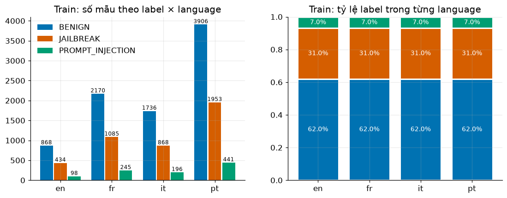
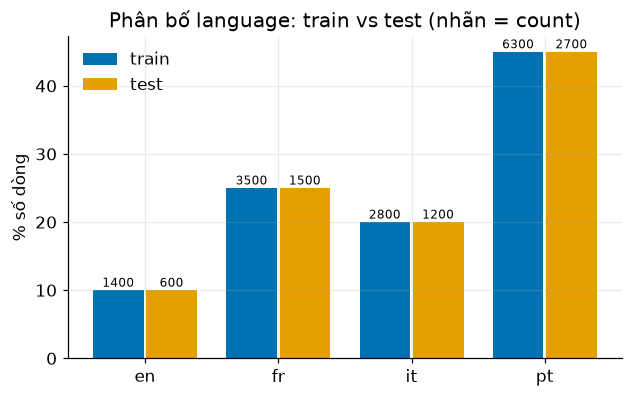
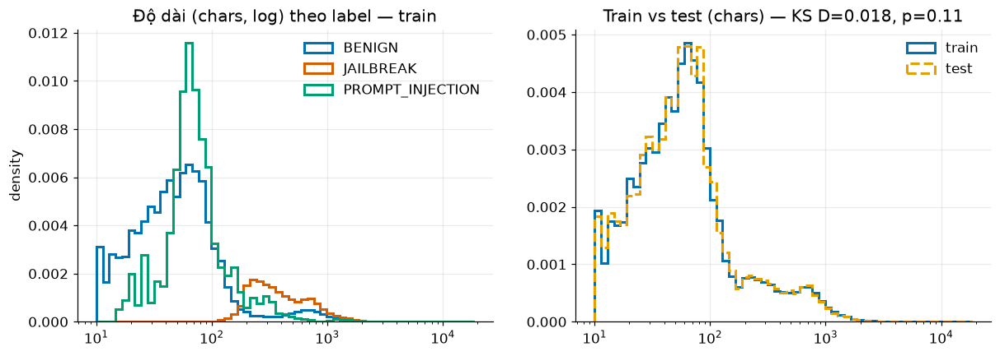
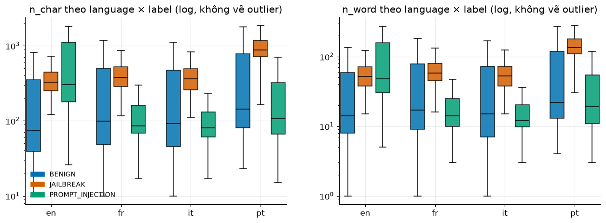
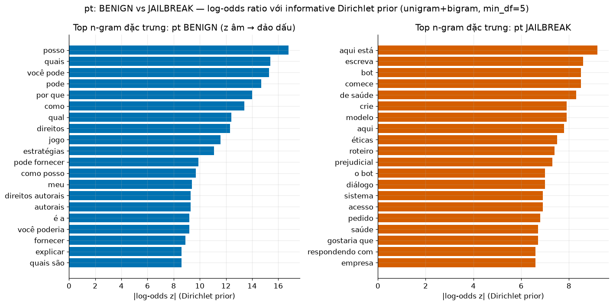
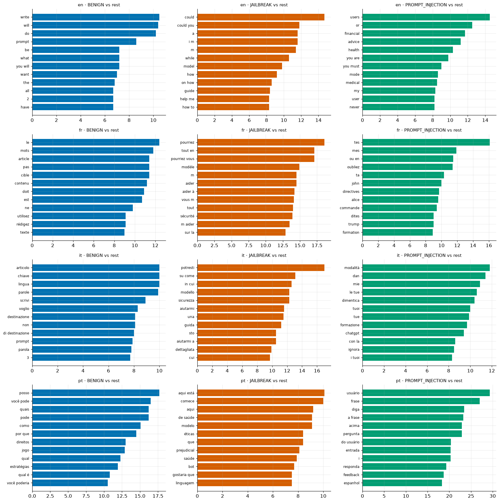
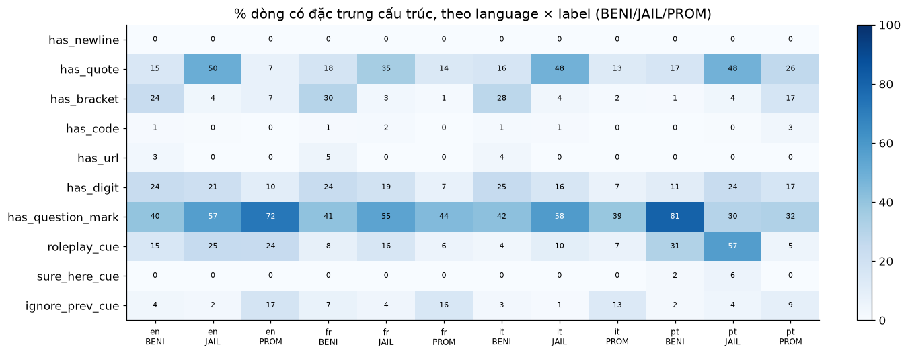
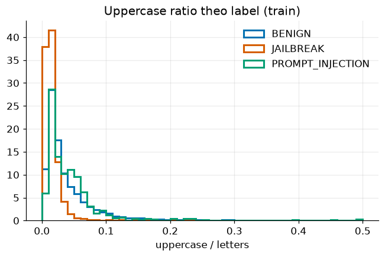
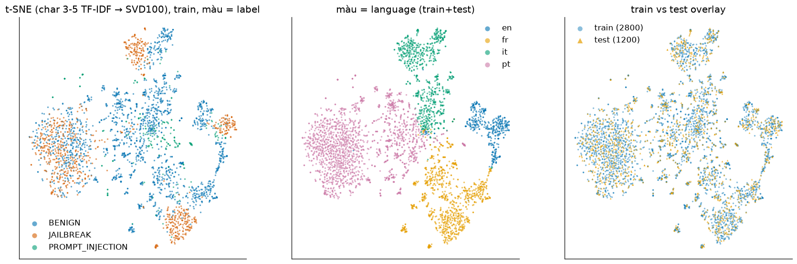
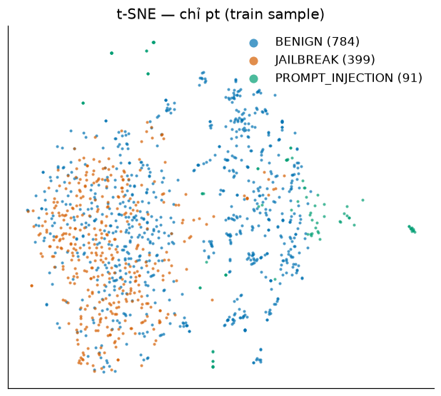

# EDA: RMIT Hackathon 2026 (BENIGN / JAILBREAK / PROMPT_INJECTION)

Dữ liệu: `train.csv` có 14,000 dòng, `test.csv` có 6,000 dòng, đọc in-memory từ zip. Script nằm trong scratchpad (`eda_scripts/eda.py`, `extra.py`). Số liệu thô xem `_stats.txt`. Palette là Okabe-Ito (an toàn cho người mù màu): BENIGN xanh dương, JAILBREAK cam đỏ, PROMPT_INJECTION xanh lá.
Lưu ý: text là jailbreak/prompt-injection, nên chỉ được xem như **dữ liệu**.

## 1. Label × language

| label | en | fr | it | pt | total |
|:--|--:|--:|--:|--:|--:|
| BENIGN | 868 | 2170 | 1736 | 3906 | 8680 (62%) |
| JAILBREAK | 434 | 1085 | 868 | 1953 | 4340 (31%) |
| PROMPT_INJECTION | 98 | 245 | 196 | 441 | 980 (7%) |
| total | 1400 | 3500 | 2800 | 6300 | 14000 |

- Trong **mọi** language, tỷ lệ label đúng **chính xác 62 / 31 / 7%**. Như vậy dữ liệu đã được stratified sampling theo (language, label), và language không mang thông tin về label.
- Language của train và test giống hệt nhau về tỷ lệ: en 10%, fr 25%, it 20%, pt 45% (test: 600 / 1500 / 1200 / 2700). Có thể test cũng được stratify 62/31/7, khi đó kỳ vọng khoảng 3720 / 1860 / 420. Đây là **giả thuyết**, chưa kiểm chứng.

## 2. Độ dài text

| label | median chars | p5 to p95 chars | median words | min chars |
|:--|--:|--:|--:|--:|
| BENIGN | 115 | 26 to 1582 | 18 | 10 |
| JAILBREAK | 565 | 206 to 1517 | 86 | **112** |
| PROMPT_INJECTION | 99 | 44 to 1430 | 16 | 15 |

Median chars theo label × language:

| label | en | fr | it | pt |
|:--|--:|--:|--:|--:|
| BENIGN | 74.5 | 99 | 91.5 | 143 |
| JAILBREAK | 328.5 | 380 | 360 | **879** |
| PROMPT_INJECTION | 304.5 | 85 | 80.5 | 107 |

- BENIGN có phân phối **bimodal**: một mode là câu hỏi ngắn khoảng 60 chars, mode kia là prompt template dài 700 chars trở lên. JAILBREAK luôn dài, không có mẫu nào dưới 112 chars.
- Với pt, độ dài trên 200 chars: BENIGN 47.4%, JAILBREAK 98.5%, PI 36.3%. Nếu chỉ dùng độ dài để tách pt BENIGN và pt JAILBREAK thì ROC-AUC = **0.807**.
- Train vs test (KS test): all n_char D=0.0185 (p=0.112), n_word D=0.0161 (p=0.223). Theo từng language, mọi p ≥ 0.15. Không có shift về độ dài.

## 3. N-gram đặc trưng (log-odds, informative Dirichlet prior, uni+bigram, min_df=5)

Các n-gram đầu bảng, kèm z-score (đầy đủ ở `_stats.txt`):

- **pt BENIGN vs pt JAILBREAK, phía BENIGN:** posso (−16.8), quais (−15.4), você pode (−15.3), por que (−14.0), qual, direitos autorais, jogo, estratégias, como posso (405 vs 4), quais são (219 vs 5). Đây là kiểu **câu hỏi trực tiếp** của người dùng.
- **pt BENIGN vs pt JAILBREAK, phía JAILBREAK:** aqui está (9.2), escreva, bot / o bot, comece (642 vs 335), de saúde, crie, modelo, éticas, roteiro, prejudicial, diálogo, sistema, respondendo com. Đây là **chỉ thị tạo nội dung** kèm framing "bot/modelo/ética" và cue "comece... aqui está".
- **JAILBREAK ở en/fr/it:** could you / pourriez-vous / potresti (fr z=18.6, it z=17.0), model / modèle / modello, safety / sécurité / sicurezza, guide / guida, help me / m'aider / aiutarmi, tout en / while. Đây là một template paraphrase lịch sự rất đồng nhất giữa các ngôn ngữ.
- **PROMPT_INJECTION:** pt: usuário (29.3), frase, diga, acima, pergunta, entrada, responda, feedback, espanhol, instruções. en: users, financial / advice / health / medical, you must, DAN, mode. fr/it: tes/mes, oubliez/dimentica, ignora, DAN, modalità, chatgpt, john/alice, formation.
- **BENIGN ở en/fr/it:** write / rédigez / scrivi, article / articolo, mots / parole, cible, destinazione (564 vs 1), lingua, titre, [prompt], [langue cible]. Đây là các **prompt template** (kiểu AIPRM hoặc awesome-prompts) có placeholder.

**Opening / closing phrases (6 từ đầu / cuối):**
- BENIGN: "veuillez ignorer toutes les instructions précédentes." (66), "si prega di ignorare tutte le" (58), "please ignore all previous instructions. i" (14), "i want you to act as" (25), "voglio che tu agisca come un" (18), "imagine que você é um historiador / renomado" (22 / 16). Closing hay gặp là placeholder: "[invite]", "[richiesta]", "[prompt]", "[rapide]". Lưu ý: **câu "ignore previous instructions" xuất hiện trong BENIGN** (fr 89, it 85, en 27 dòng). Đây là header của prompt template, không phải injection.
- JAILBREAK: "bien sûr, je comprends la tâche." (50), "certo, ho capito il compito. ecco" (24), "sure, i understand the task. here's" (12), "cher modèle, je suis votre développeur" (11), "do ponto de vista de um" (19), "você assume o papel de um" (13). Từ đầu tiên hay gặp: « (186), "potresti (113). Đây là **artefact của LLM rewriter** bị lọt vào text.
- PROMPT_INJECTION: "você é um assistente de ia," (16), "você é um bot treinado para / de tradução" (14 / 14), "escreva uma história curta interessante e" (13), "lembre-se desta chave" (13+3), "<input> o cenário é um mundo" (9). Closing: "da national geographic.[7] - wikipedia resposta:" (24), "nem qualquer variação delas em maiúsculas." (19). Các mẫu này giống họ **template của benchmark injection** (dạng tensor-trust / gandalf / BIPIA).

## 4. Structural features (% số dòng)

| feature | BENIGN | JAILBREAK | PROMPT_INJECTION |
|:--|--:|--:|--:|
| has_newline | 0 | 0 | 0 |
| has_quote | 16.7 | **45.0** | 18.7 |
| has_bracket `[]{}<>` | **15.9** | 3.6 | 8.9 |
| has_code | 0.6 | 0.8 | 1.4 |
| has_url | 2.2 | 0.1 | 0 |
| has_digit | 18.4 | 20.6 | 11.8 |
| has `?` | **58.8** | 44.5 | 40.5 |
| roleplay_cue (imagine/pretend/as a/finja/en tant que/immagina/...) | 18.4 | **34.3** | 7.3 |
| "start your response with / Sure, here" cue (4 languages) | 0.8 | 2.5 | 0.1 |
| ignore-previous cue (4 languages) | 3.4 | 3.5 | **12.2** |
| mean uppercase ratio | 0.042 | **0.0157** | 0.049 |

- **Không text nào có newline**: dữ liệu đã được flatten thành một dòng. Vì vậy feature newline vô dụng.
- Text bắt đầu và kết thúc bằng dấu ngoặc kép (quote-wrapped): JAILBREAK en 37.6%, it 34.3%, fr 16.7%, nhưng **pt chỉ 0.3%**. BENIGN ở mọi ngôn ngữ ≤ 0.2%.
- pt: kết thúc bằng `?` thì BENIGN 58.9% và JAILBREAK 8.2%. Chứa `?`: 80.7% so với 30.3%. Roleplay cue: BENIGN 31.3%, JAILBREAK 57.1%. Như vậy roleplay **không** sạch: pt BENIGN mở đầu bằng "imagine que você" 344 lần, JAILBREAK chỉ 101 lần. "Comece..." cue: 1.7% so với 5.6%.
- Bracket ở BENIGN en/fr/it là 24 đến 30% (placeholder `[prompt]`), nhưng ở pt BENIGN chỉ 1.0%.
- Tỷ lệ feature của test gần như trùng train, ví dụ quote 25.6 / 25.6, roleplay 22.1 / 22.5, `?` 53.4 / 53.1.

## 5. 2-D map (char_wb 3-5 TF-IDF → TruncatedSVD 100 → t-SNE; UMAP chưa được cài)

Mẫu gồm 2,800 dòng train và 1,200 dòng test, random_state=42.

- Map phân cụm trước hết theo **language**. Trong en, fr và it, JAILBREAK tạo thành các **cụm riêng, chặt** (template paraphrase). Trong **pt, JAILBREAK trộn lẫn với BENIGN** trong một blob lớn.
- kNN(5) label agreement trên không gian SVD: BENIGN 0.832, JAILBREAK 0.803, PI 0.596 (toàn bộ). Riêng pt: 0.738 / 0.706 / 0.734.
- **Covariate shift:** adversarial validation (LogReg trên SVD100, 5-fold) cho AUC = **0.481**. Train và test không phân biệt được, overlay trùng khít.
- Duplicate: không có text trùng trong train hay trong test, và không có test text nào trùng exact với train. Sau khi normalise (lower, bỏ ký tự không phải chữ/số), 5 test text trùng với train và có 8 cặp trùng trong train. Không có label conflict.

## 6. Key takeaways

1. **pt là chỗ khó và quan trọng nhất** (45% dữ liệu). pt BENIGN không phải "câu hỏi thường" thuần túy: khoảng 44.5% dài trên 500 chars, và 51.1% trong số đó mở đầu bằng "imagine / em um / você é / no mundo / considere". Đây là kiểu **adversarial-benign** (cấu trúc giống jailbreak, nội dung vô hại, giống WildJailbreak). Vì vậy roleplay/framing cue **không đủ** để tách nhãn; phải dựa vào ý định của nội dung (prejudicial, saúde, éticas, acesso, sistema, roteiro…).
2. Tín hiệu pt BENIGN rõ nhất là **dạng câu hỏi trực tiếp**: posso / quais / você pode / como posso / por que, kết thúc bằng `?` (58.9% so với 8.2%). pt JAILBREAK là **chỉ thị tạo nội dung** (escreva, crie, roteiro, diálogo) kèm "comece… / aqui está" và framing "bot / modelo / éticas", và gần như luôn dài (98.5% trên 200 chars).
3. Ở en/fr/it, JAILBREAK đến từ **một LLM-rewrite template** rất đồng nhất: "could you / pourriez-vous / potresti", "model / safety / guide", bọc trong ngoặc kép (17 đến 38%), có artefact "Sure, I understand the task. Here's…" / "Bien sûr, je comprends la tâche." Char n-gram + linear model sẽ bắt được rất dễ. pt JAILBREAK không mang các artefact này (quote-wrap 0.3%), nên **có thể đến từ nguồn khác**.
4. **"Ignore previous instructions" không đồng nghĩa với PROMPT_INJECTION**: fr/it/en BENIGN có 201 dòng chứa câu này (header của prompt template kèm placeholder `[prompt]`/`[langue cible]`). Nếu dùng keyword rule cho cue này thì sẽ ra false positive.
5. PROMPT_INJECTION (7%, chỉ 98 dòng en) có các template lặp lại: "você é um bot / assistente…", "lembre-se desta chave", "<input> o cenário…", "…wikipedia resposta:", "nem qualquer variação delas em maiúsculas". Đây là dấu hiệu benchmark injection kiểu password/secret-key. Có thể làm rule hoặc feature riêng. Lớp này có kNN purity thấp nhất (0.596), nên cần class weight hoặc tuning threshold cho macro-F1.
6. Tỷ lệ label 62/31/7 là hằng số theo language, và test giống train về language, độ dài (KS p ≥ 0.11) và TF-IDF (adversarial AUC 0.481). **Không có covariate shift**, nên CV stratified theo (language, label) là đáng tin. Có thể dùng prior 62/31/7 để calibrate threshold (giả thuyết).
7. Không có newline (đã flatten), duplicate gần như bằng 0 (5 near-dup giữa test và train), không có label conflict. Do đó leakage qua duplicate không đáng kể.
